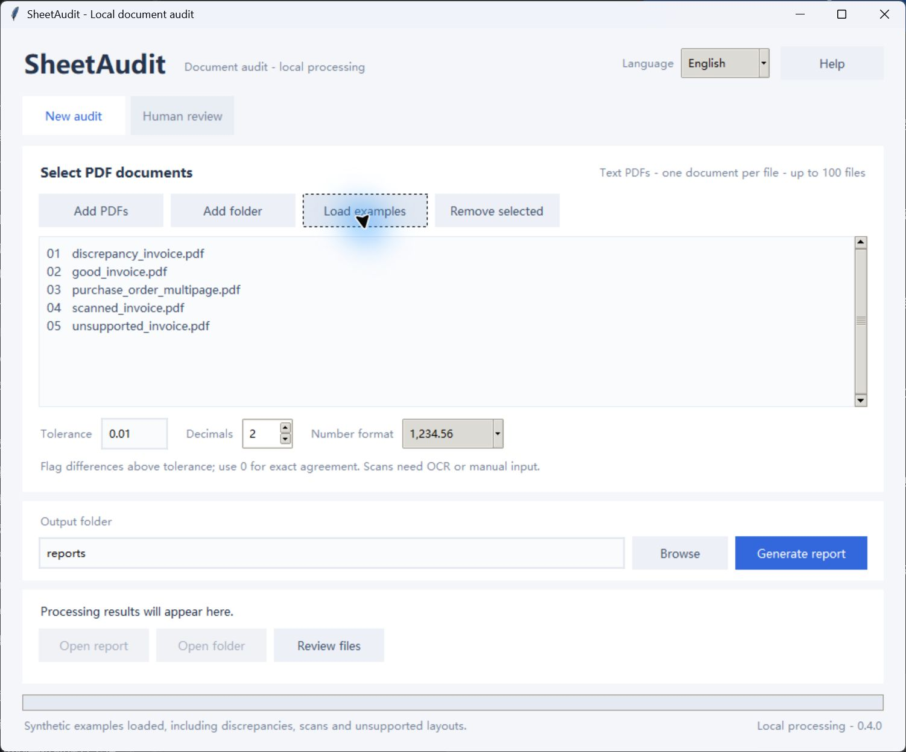

# SheetAudit AI 0.4.0

[Agent skill](SKILL.md) · [MIT license](LICENSE)

Turn purchase-order and invoice PDFs into an Excel report on your own computer. Extract header fields and line items, check quantity × unit price and document totals, and retain exceptions for human review.

The default workflow uses local rules. It needs no API key, account or cloud service. It does not post to accounting software or approve payments.

## Release scope

The desktop interface, CLI messages, Excel reports and review workbooks support English and Simplified Chinese. English is the default. Public demo PDFs and this guide are English; [a Chinese guide](README.zh-CN.md) is also available. See [desktop setup](DESKTOP.md) for the portable Windows application.



## Choose a language

In the desktop window, select **English** or **简体中文** at the top right. The app remembers the choice locally. Switching preserves selected files, entered settings and the current view without resizing the window. Reports created afterward use that language; existing reports remain unchanged. The selector is locked while a batch is running.

For the CLI, `--language` works before or after a subcommand:

```text
python -m sheetaudit audit examples/pdfs --out reports/demo-en --language en
python -m sheetaudit --language zh audit examples/pdfs --out reports/demo-zh
```

Source descriptions, customer names, amounts and evidence stay in their original language. Review workbook language is detected from its metadata, so either UI language can import English, Chinese and legacy Chinese workbooks. JSON records retain their canonical vocabulary and stable English issue codes for compatibility. Language preference files contain only the language code, not document names or data. You can also set `SHEETAUDIT_LANGUAGE=en` or `zh` for the CLI default.

## Python project and agent skill

Python 3.10+ is required. The tested environment is Windows with Python 3.12.14. After downloading the source, open a terminal in the project root:

```powershell
python -m venv .venv
.\.venv\Scripts\python.exe -m pip install -c constraints-tested.txt -e .
.\.venv\Scripts\python.exe -m sheetaudit audit examples/pdfs examples/regressions --out reports/demo-001
.\.venv\Scripts\python.exe -m unittest discover -s tests -q
```

On macOS/Linux, substitute `.venv/bin/python` for the Windows executable path. These platforms have not been validated. Initial dependency installation requires network access. Default document processing then runs locally.

For an AI coding agent, load the root `SKILL.md` and use this folder as the project root. Keep `src/`, `scripts/`, `references/`, the example PDFs and `pyproject.toml` with the skill. The skill guides extraction, privacy summaries, arithmetic interpretation and local human corrections.

You can also install the skill with the [skills CLI](https://github.com/vercel-labs/skills), which requires Node.js 22.20 or later:

```text
npx skills add marxpatrick74-ctrl/marxpatrick --skill sheetaudit-ai
```

Choose the target agent when prompted. Skill installation copies the instructions and resources; install the Python project dependencies in the copied skill folder before running audits. The CLI supports an opt-out for its telemetry; see its documentation. A directory listing or leaderboard placement is not guaranteed by publication.

## Supported pilot

- Text-based Chinese or English invoices and purchase orders with common field labels and consistently aligned line-item columns.
- One document per PDF, including supported continuation pages.
- Up to 100 PDFs per batch, 100 pages and 50 MB per file. Directory inputs scan one level.
- Decimal arithmetic with configurable rounding. Default tolerance is 0.01; differences strictly greater than the tolerance are flagged.
- Missing values stay unknown. They are not replaced with zero or inferred from arithmetic.

Scans, handwriting, complex merged layouts, multiple documents in one PDF, per-line discounts and tax conventions may require separate assessment and manual input. Optional Tesseract/Ollama integrations exist, but their real-engine recognition quality has not been validated. The portable desktop does not enable those integrations.

## Output and corrections

`report.xlsx` is a snapshot containing fields, line items, discrepancies and source evidence. Each document also has an editable `review.xlsx` and supporting local JSON files.

Editing the report does not recalculate it. Correct the document's `review.xlsx`, save it, and run the human-review workflow below. The original PDF and prior report remain unchanged. A real reviewer must confirm coverage and provide the actual review signature. No identity or completeness sign-off is invented.

For an English-keyed correction file, copy the generated `review-template.json` to a new local file, correct `fields` / `items`, and fill in the real `reviewer`, timezone-aware `reviewed_at`, `notes` and `coverage_confirmed`. Resolve extraction notices only with a recorded reason. Keep source hashes unchanged. Do not let an agent invent a human sign-off.

```text
python -m sheetaudit review reports/demo-001/documents/<document-id>/extracted.json --corrections path/to/corrections.json --source path/to/original.pdf --out reports/review-001
```

The same command accepts the generated `review.xlsx` as `--corrections`. See [the schema](references/schema.md) for field definitions. The selected language controls the new report and review workbook; it does not restrict which workbook language can be imported.

For a privacy-reduced status summary, run:

```powershell
.\.venv\Scripts\python.exe -m sheetaudit summary reports/demo-001
```

## Privacy and validation

Document processing is local by default. Outputs and raw-evidence JSON files are not encrypted. Keep customer files outside source control and automatic cloud-sync folders. Do not attach real invoices, customer records or unredacted reports to public issues.

The project has 67 automated tests. The bundled PDFs are synthetic examples, including intentional discrepancies and unsupported cases. They are not client work or a claim of real-world invoice accuracy. Arithmetic agreement does not establish completeness, invoice authenticity, tax correctness or permission to pay.

Report a reproducible problem using synthetic or authorized redacted documents, the version, expected result and actual result. Third-party libraries and the bundled desktop runtime retain their own licenses and notices. See `THIRD_PARTY_NOTICES.md`.

## Demo cases

| PDF | Expected behavior |
| --- | --- |
| `good_invoice.pdf` | Two lines; no arithmetic differences; human coverage review still required. |
| `discrepancy_invoice.pdf` | First line states 42.50 instead of 3 x 12.50 = 37.50; one 5.00 difference. |
| `purchase_order_multipage.pdf` | Two identical legitimate rows on separate pages; preserve both. |
| `unsupported_invoice.pdf` | Ambiguous quantity and missing price remain unknown. |
| `scanned_invoice.pdf` | Image-only; default rules mode must flag missing text/items. |

Run `./run_demo.ps1` on Windows for an automatically named demo output directory. It creates a project virtual environment and installs dependencies if necessary. A supported Python installation and internet connection are needed for first-time setup.

To regenerate demo PDFs, install the optional dependencies with `python -m pip install -c constraints-tested.txt -e ".[demo]"`, then run `python scripts/make_examples.py`. Regression fixtures and their hash-bound benchmark are preserved separately. See [benchmarking](BENCHMARK.md) and [validation](VALIDATION.md).

## License and contributions

Original source and synthetic examples are available under the [MIT license](LICENSE), allowing use, modification and redistribution with the required notice. Dependencies keep their own licenses. Please use synthetic reproductions in issues and pull requests. Never submit private invoices or credentials.
