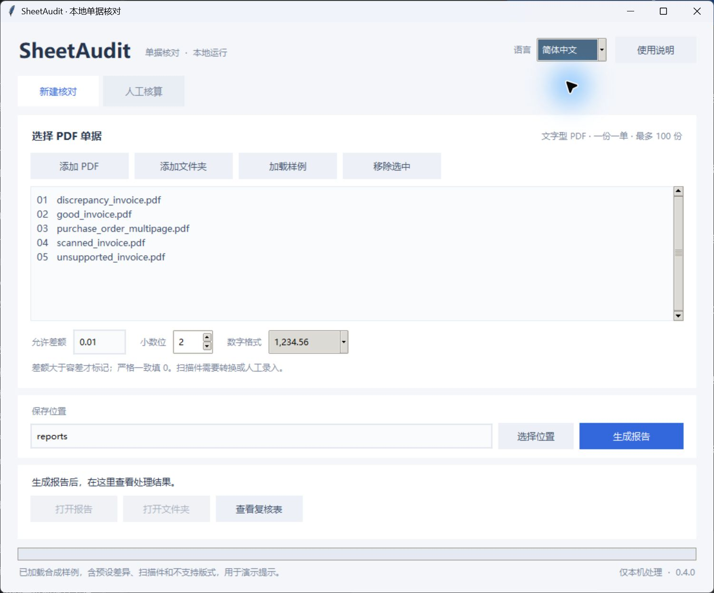

# SheetAudit AI 0.4.0

[English](README.md) · 简体中文

本地提取采购单、发票 PDF 的字段和明细，核对数量 × 单价、明细小计及单据总额，生成 Excel 差异报告。默认无需账号、API 密钥或云服务，不自动财务入账或批准付款。

## Windows 桌面版

从 Releases 下载 `SheetAudit-Desktop-v0.4.0-Windows-x64.zip`，完整解压后打开 `program/SheetAudit.exe`，保留 `_internal` 文件夹及许可证文件。无需安装 Python。报告默认保存在外层 `reports` 文件夹，需要 Excel、WPS 等兼容软件打开。

右上角可选择 **English / 简体中文**，程序记住上次选择。切换不会清空文件列表或修改设置，也不会改变窗口大小。运行中暂时锁定语言选择；报告使用任务开始时的语言。



点击“加载样例”体验，或添加已获授权的 PDF，选择保存位置后点击“生成报告”。检查差异、无法核验项和待复核提示。如需修正，编辑并保存 `review.xlsx`，填写实际复核人、带时区的时间、说明和完整性确认，再到“人工核算”选择对应原件重新核算。

## Python / Skill 版

需要 Python 3.10+，当前验证环境为 Windows x64 / Python 3.12.14。

```powershell
python -m venv .venv
.\.venv\Scripts\python.exe -m pip install -c constraints-tested.txt -e .
.\.venv\Scripts\python.exe -m sheetaudit audit examples/pdfs --out reports/demo-zh --language zh
.\.venv\Scripts\python.exe -m unittest discover -s tests -q
```

使用 `--language en` 生成英文报告；参数可放在子命令前或后。默认英文，也可通过 `SHEETAUDIT_LANGUAGE` 环境变量设置命令行默认语言。

```text
npx skills add marxpatrick74-ctrl/marxpatrick --skill sheetaudit-ai
```

Skill 安装需要 Node.js 22.20+；它复制指令和资源，不代替 Python 依赖安装。代理应以 Skill 所在文件夹作为项目根目录，按 `SKILL.md` 操作。

## 数据和限制

语言切换只影响程序提示、表头和状态；票据原文、客户名称、数字及证据不做翻译。两种界面都能导入中英文复核表及旧中文复核表。原 PDF 和提取记录的指纹绑定仍会校验。内部 JSON 保留原有词汇和英文检查代码，以兼容历史记录。

`report.xlsx` 是固定快照，直接编辑不会重新计算。未知值不等于零，默认容差 0.01，差异绝对值严格大于容差才标记。未解决漏行或无法核验时，不能声称单据完全正确。

每批最多 100 份 PDF，每份最多 100 页、50 MB。扫描件、手写和复杂版式可能需要 OCR 或人工处理；真实 OCR/模型效果尚未验证。示例均为虚构数据，不代表真实客户准确率。

默认处理在本机进行，输出未自动加密。不要把真实票据、客户信息或未脱敏报告上传到公开仓库。源代码和原创示例采用 MIT 许可证，第三方组件保留各自许可证。
